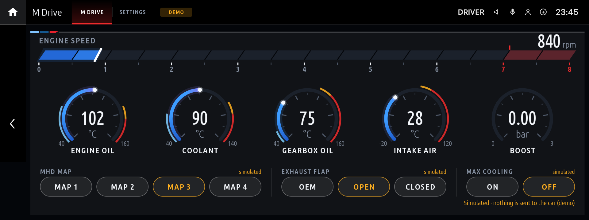

# M Drive for iDrive 7

A native BMW iDrive 7 app with an RPM bar, five engine gauges, MHD maps 1–4, exhaust-flap control,
and Max Cooling on one screen. Touch and the iDrive controller reach every action.



`apps/m_drive` is the only app in this repository. Its required control modules are included in
that folder. The build tools, runtime, renderer, emulator, and deployment scripts keep the original
app-kit structure.

## Preview without a car

Install Python 3 and Node.js, then run:

```sh
python3 kit/tools/build.py --preview-only m_drive
node kit/tools/emu.js m_drive --preview-only
```

Open <http://localhost:8077>. Click the controls or use `[` and `]` to turn the controller,
Enter to press it, and the arrow keys to tilt it. The first emulator launch uses demo data.
Demo selections are simulated and send nothing to a car.

For PNG frames:

```sh
node kit/tools/preview.js dist/m_drive preview/m_drive wait=3 render
```

## Verify the app

```sh
python3 kit/tools/verify_repository.py
node kit/tools/test_m_drive.js
node kit/tools/test_runtime.js
```

The M Drive suite runs the staged app with the real runtime against simulated vehicle signals and
diagnostic replies. It checks all nine actions, exact command bytes, command acceptance, stale
readings, demo mode, screen changes, the cooling RPM guard, and OEM hand-back while busy.
CI runs the app checks on Node 8.16.2, the head unit's runtime, and Node 22.

## Build for the head unit

An installable package requires BMW's `oap-sdk`, extracted from your own head unit. The SDK,
vehicle catalogs, credentials, and generated packages are excluded from this repository.
The extraction tool documents its inputs in [extract_sdk.js](kit/tools/extract_sdk.js).

After placing the SDK at `oap-sdk/`:

```sh
python3 kit/tools/build.py m_drive
python3 kit/tools/make_kit.py m_drive
```

The app build creates `dist/m_drive@1.0.0.mgu` and its `.tgz` package. The car-kit command creates
`dist/mgu-custom-apps/` with the installer and renderer. Follow the generated
`dist/mgu-custom-apps/README.txt` for installation. [deploy/car/README.txt](deploy/car/README.txt)
describes the head-unit commands.

Car controls ship Off. Enable **Settings > Car controls** only for your MHD-equipped car.
Max Cooling On requires fresh live RPM over 500. Read [the app reference](apps/m_drive/README.md)
for protocol support and limits. This app has not yet been validated on a physical car or HMI.

## Repository layout

```text
apps/m_drive/       The only installable app, including its control modules
kit/runtime/        Native app runtime, gauges, fonts, and diagnostic transport
kit/emu/            Browser renderer and emulator assets
kit/renderd/        Head-unit renderer, controller gate, and prebuilt binaries
kit/platform/       Platform permissions
kit/localization/   Translation credits and additional font atlases
kit/tools/          Build, preview, SDK extraction, and verification tools
deploy/             Car-kit creation and installation scripts
docs/               M Drive preview and emulator reference
mgu-repo.json       MGU Store repository catalog
```

## Source and license

This standalone repository derives from
[cauliflowermossgrape/idrive7-apps](https://github.com/cauliflowermossgrape/idrive7-apps).
It starts with a fresh history and includes only M Drive under `apps`.
The original MIT license and translation/font notices are retained.

[m_drive_contract.json](kit/tools/fixtures/m_drive_contract.json) records the source commit,
module hashes, and telemetry candidates used for the extraction. The export script reproduces
the core file selection from the original checkout into an empty directory:

```sh
python3 kit/tools/export_standalone.py /path/to/original-checkout /path/to/empty-destination
```

See [LICENSE](LICENSE) and [NOTICE.zh-CN.md](NOTICE.zh-CN.md) for attribution.
